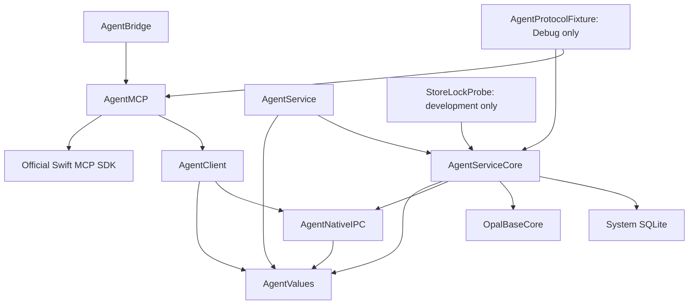
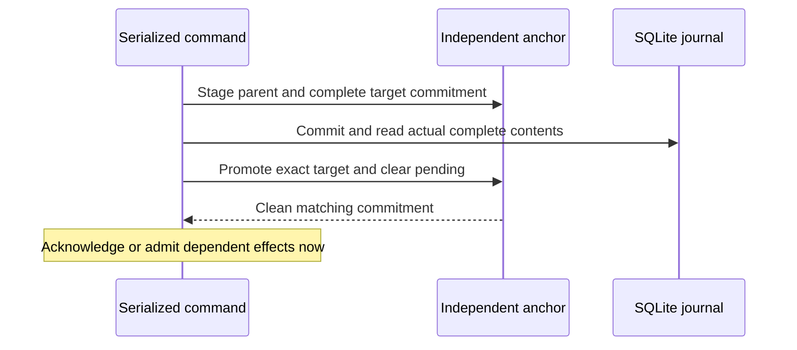

# Architecture

The package separates public values/client access from the internal wallet authority. The source engine uses real SQLite and public ordinary-BCH Base APIs with injected external boundaries. Native XPC source boundaries and a thin MCP adapter are present. Service-only Keychain access, qualified signed composition, installed lifecycle and Wallet owner UI remain absent. Ordinary native construction is unavailable without trusted qualified prerequisites; shipping entries never select a synthetic or weaker runtime.

## Module and runtime ownership

These are the primary source dependencies; `Package.swift` records the complete target graph. `AgentServiceCore` has no library product. Public clients receive no Base plans, private accounts, descriptors or signing authority. The ordinary-BCH Core product excludes Base's optional privacy integrations; package resolution and actual compilation/linking are distinct evidence. `StoreLockProbe` and all fixtures are excluded from installed artifacts.

`DurableWalletStore` owns the same-store writer lease, SQLite journal and continuity coordinator. The coordinator retains the lease even if a caller releases the wrapper. Startup invalidation finishes before integration authority becomes available. A failed continuity check leaves the authenticated owner recovery facade available without integration access. Each store configures and retains one payment engine and one receive engine; a second configuration fails rather than creating another local relay slot. The shipping entries do not yet construct this composition.

Wallet remains the trusted owner-control deputy and must never reconstruct the Agent wallet, synchronize it independently or open its storage. Its personal wallet security and key namespace remain separate.

## Public capabilities and service dispatch

`AgentValues` declares typed requests and safe results for the twelve integration methods below. `CapabilityRequest` uses one service envelope (`protocolVersion`, `method`, `parameters`), with its version taken from `ServiceStatus.currentProtocolVersion`; this version is separate from MCP negotiation. Request decoding rejects unknown wallet-command fields, including nested selectors, and validates explicit network, opaque IDs, request-key grammar and pages of at most forty entries. Swift values carry exact integer satoshis. The MCP adapter uses exact decimal integer strings at its JSON boundary; UInt64 provenance and revision counters also remain decimal strings. [MCP](MCP.md) owns the wire contract and bounded profiles.

`CapabilityClient` accepts a separately injected `CapabilityTransport`, checks response version/method and supported context/shape invariants, and defaults to `UnavailableCapabilityTransport`. The existing status-only client is unchanged. The clients check transport values; the internal `CapabilityService` dispatches against the payment and receive engines under a trusted connection/session. The clients do not authenticate a peer, authorize a grant, verify chain evidence or approve a payment. The bridge exposes static tool discovery and strict dispatch; its default client remains unavailable. Native transports require an explicitly supplied trusted deployment provider and never start a live service themselves.

| Integration method | Required service scope | Request/result direction |
| --- | --- | --- |
| `list_wallets` | `read` over explicitly authorized accounts | Bounded authorized wallet identities |
| `list_accounts` | `read` | Explicit wallet/network and bounded account identities |
| `get_balance` | `read` | Explicit account and retained balance observation |
| `list_transactions` | `read` | Explicit account, stable cursor and bounded transaction projection |
| `list_utxos` | `read` | Explicit account, stable cursor and bounded UTXO projection |
| `get_sync_status` | `read` | Cached observation/status without starting synchronization |
| `synchronize_account` | `sync` | Explicit keyed effect and pollable operation identity |
| `create_receive_request` | `receive` | Explicit keyed allocation and retained operation identity |
| `prepare_payment` | `prepare` | Keyed address/amount/constraints and immutable payment preview |
| `submit_payment` | `submit` | Existing immutable operation and current submission state |
| `get_operation` | `read` plus originating-principal visibility | Operation identity or retained effect key; observational lookup |
| `cancel_operation` | `cancel` plus originating-principal visibility | Cancellation only while provably unsubmitted |

The service supplies authorized discovery, cached public projections and durable generic sync/receive handling. A missing snapshot is explicit unavailable data; synchronization placeholders have no observation. Receive results distinguish pending, allocated and closed. Payment results distinguish historical closure reason from the current restriction, liability, blocker, evidence support/revision and admission count. UTXO reservations reveal an operation ID only to its current origin grant; other reservations remain opaque. Observations carry provider, view, tip, sequence and generation. Runtime readiness is separate: retained freshness cannot establish current key or provider availability. A trusted captured-facts projection may report runtime readiness; its default is unavailable and it cannot open custody or refresh chain state.

Final result disclosure rechecks the current peer/session, connection binding, generation, account scope and origin under the continuity serializer, including after asynchronous engine calls. Integration and grant identities remain distinct; credential rotation retains the original namespace without giving a newly enrolled grant access to an old grant's history. Unknown and foreign operation lookup share the same unavailable error. Command responses use their own command scope, including cancellation without an additional read prerequisite. Safe errors contain a fixed code rather than internal error descriptions or journal payloads. Cached reads and polling do not synchronize, select inputs, allocate addresses, open seed custody, sign, reconcile or relay. They may durably retire newly observed expired authority and invalidate its unsubmitted work; unchanged reads produce no authoritative write.

The public preparation request carries address text. The service validates its network and normalizes it to a supported BCH locking script with Base before entering the internal engine. The MCP adapter must not acquire engine access or duplicate that normalizer. The client cannot prove address-to-script correspondence; raw address-text equality must not reject an equivalent supported encoding when retrying a retained normalized request.

`OwnerControlClient` and the internal `OwnerControlService` use a separate typed endpoint, absent from `CapabilityCall`. It covers custody setup/export/seed restore, journal recovery through service-cataloged opaque source handles, public discovery, enablement, enrollment/rotation/revocation, approval policy, individual preview approval/rejection and one-admission signed-byte recovery relay. No caller supplies a file path, canonical root, role or authentication flag. Seed and one-time credential material are non-Codable owner values with redacted descriptions and reflection; integration results never contain them. Enrollment persists its verifier before one-time delivery, so a lost delivery requires replacement by rotation rather than credential lookup.

Verified owner peer/connection authority permits status, recovery metadata, account discovery, bounded payment activity, payment status, preview/relay review contexts and historical relay receipts without invoking human authentication. These reads cannot act as consent for any effect. Custody reads report present-but-unverified metadata without opening a key. Every other owner call requires a fresh proof from an explicitly injected trusted consent provider. A challenge binds connection, nonce and action purpose; every sensitive call also binds its canonical request commitment; exact payment actions bind the reviewed context. The proof is rechecked at engine authorization and after asynchronous work, including connection invalidation and age. Native connection code configures exact peer requirements and a trusted Wallet consent callback, but no production qualifying provider or Wallet authentication UI is supplied. Injected proofs and wire tests remain source/synthetic evidence only.

Ordinary approval/rejection uses a full safe preview context with wallet/account/network, current generation/policy and origin credential identity. The engine compares the service commitment to the full retained preview inside the same payment transaction. Signed-byte relay uses a different context containing the stored transaction digest, current generation/policy, evidence revision and account liability commitment. Its retained key produces a historical receipt; polling or replay cannot admit another relay. Secret export compares current custody and generation after asynchronous derivation, and receipts project the retained command and current payment in one serialized observation.

## Principals and retained request identity

| Principal | Required production evidence | Authority |
| --- | --- | --- |
| Owner | Exact expected Wallet identity, correct user and purpose-scoped fresh human authentication | Setup, enrollment, rotation/revocation, policy, exact-payment approvals and recovery. |
| Integration | Expected bridge identity plus an owner-issued 256-bit bearer credential | Current wallet/account/network/capability scope only. |
| Service | Exact expected service identity verified reciprocally | Sole authorizer, writer, signer and relay coordinator. |

The internal core consumes injected peer and authentication evidence. This proves decisions over evidence. Compiled native source configures operating-system requirements before activation; evaluated signed identity enforcement remains unqualified. [Deployment](Deployment.md#reciprocal-peer-verification) owns the required signed peer relationships. Team-only matching, launcher metadata, paths, grant IDs, MCP metadata and claimed roles provide no authority. A signature alone supplies no fresh human consent.

Enrollment commits the verifier and scope before one-time credential delivery. Lost delivery requires rotation, not secret lookup. The chosen host explicitly injects its credential into the bridge environment; the shared bridge cannot retrieve another integration's secret by grant ID. Host storage and theft by arbitrary same-user processes remain explicit limits.

Sessions bind connection, principal, credential generation and wallet generation. Every operation, sensitive result and relay handoff checks current authority. Rotation preserves the stable integration namespace and authorized historical lookup while invalidating old sessions and unsubmitted work. It does not rebind a possibly relayed operation to the new credential generation: that operation retains its bytes, admission count and gate, and further relay requires a fresh exact-byte owner command. Rotation never replenishes the ordinary allowance. A newly enrolled grant cannot disclose a revoked grant's historical operations merely by reusing its integration label. Recovery disables copied credentials and approvals.

Payment, synchronization and receive keys are 32 lowercase hexadecimal characters, retained by the client before sending. The namespace is wallet, stable integration, effect kind and key; account/network and every supported caller field belong to a versioned exact payload. Malformed keys are rejected. The internal payment API accepts a validated locking script and integer satoshis; the authenticated service facade owns address/network normalization before that boundary, while the MCP adapter maps strict external values to the public client. Equal retained requests reuse one operation; changed payloads conflict without another effect. A new key is a new intention, including a legitimate repeat payment to the same recipient and amount. Completion, expiry, rotation and restart never recycle keys. Current disclosure checks also apply to retained results and conflicts.

## Seed and custody boundary

`BaseSeedAccountProvider` uses BIP39, an empty passphrase and BCH BIP44 coin type 145, account zero, on explicit mainnet, testnet or chipnet. `WalletSeedVault` persists an AES-256-GCM protected mnemonic envelope plus its bound wallet, network, derivation profile, account ID and public descriptor. Save and restore enforce encrypted mode; wrong metadata, plaintext, authentication failure or mismatched derived identity cannot downgrade protection. A missing wrapping key never causes replacement over existing ciphertext.

The signing-account factory opens the verified encrypted envelope and reconstructs the actual fixed-profile Base account, independently checking its ID and public descriptor. A separate descriptor-only factory supports public discovery without wrapping-key access and cannot sign. Keys are injected and checked before key-dependent Base work and the final handoff. New-wallet creation establishes restricted, coverage-complete storage with no grant. Separate authenticated enablement requires the matching available wrapping key; enrollment is another command. Seed-only restoration preserves surviving liabilities and original proof references but cannot manufacture missing journal coverage. When the original complete journal still matches an independent endorsement, owner seed recovery qualifies that unchanged baseline before replacing its ciphertext. Recovery first disables copied authority in restricted storage; a separate restricted custody-rewrap handshake changes only the same verified wallet/network/profile/account/descriptor's encrypted payload while preserving coverage, provenance and every retained row/gate. An initially missing/unavailable injected replacement key fails before reset. The later current-key check may instead leave the already-restricted baseline with its old ciphertext; the source never creates a replacement key automatically. A crash between phases leaves restricted old ciphertext, while interrupted rewrap follows ordinary quarantine/read-back recovery.

The proposed production key is service-only Data Protection Keychain `AfterFirstUnlockThisDeviceOnly`. This source supplies no live adapter or weaker fallback. Successful decryption does not prove journal continuity. Application approval policy does not isolate signing secrets from a compromised hot-wallet service. [Deployment](Deployment.md#keychain-and-storage-boundary) records the pending custody prerequisites.

## Actual journal and continuity barrier

`SQLiteJournal` stores versioned authoritative roots and normalized grants, requests, payments, attempts, evidence, closures, approvals, gates and allocations. Identity columns and uniqueness/foreign-key constraints are cross-checked against decoded payloads. Public snapshots, custody and policy are included in the root commitment. The complete canonical format is version 2; SQLite schema version is 1. Unknown formats/databases are rejected; no migration from an operational predecessor is claimed.

The writer uses DELETE journal mode, EXTRA synchronization, fullfsync and foreign keys. Each read reconstructs all rows from a separate committed read transaction. Failed COMMIT is rolled back before read-back; a writer that cannot return to autocommit is poisoned. Uncommitted connection-local rows cannot prove success. These settings and process-termination fixtures do not prove hardware power-loss durability or Keychain atomicity.

The independent anchor is outside the database rollback domain. It binds installation, wallet, generation, format and complete state, retaining a committed reference, at most one pending target and a recovery latch. There is no default file-backed production anchor in this package.

Ambiguous writes proceed only after actual read-back proves the exact stage. Pending/mismatched state quarantines dependent effects. Generic transitions retain immutable history and liabilities. A separate payment validator permits only the engine's named transitions, retaining exact bytes, attempts, historical evidence, closures and request bindings. All authoritative facts remain covered by the complete commitment.

## Payment execution

Preparation first retains request identity and the account gate. Base creates an unsigned reviewed template with fixed input/output order, fee and change; the service attaches a conservative preview deadline and rechecks the actual Base reservation before first admission. Approval binds that exact preview, policy and generation. Signing occurs only after readiness; canonical transaction bytes and the numbered attempt are durable before transport may begin. Retried payments reconstruct the same immutable transaction, without rehydrating process-local reservations.

| State | Effect and restriction |
| --- | --- |
| `preparing` / `prepared` | One durable account gate; unsigned Base work or retained preview. Cancellation/expiry can prove unsubmitted. |
| `pendingApproval` / `ready` | Exact owner approval when required; current grant, policy, generation and live reservation remain necessary. |
| `submitting` | Durable admission and exact bytes; transport may have begun. A crash is ambiguous. |
| `uncertain` | No proof of accepted/accounted outcome; retain account liability and identical bytes. |
| `accepted` | Relay or public evidence reports acceptance; reconciliation and cleanup still hold the gate. |
| `recoveryRequired` | Known damage requiring owner repair; no timeout unlock. |
| `closed` / `invalidated` | Proven unsubmitted outcome or evidence-based reconciled closure; retained request identity. Evidence-based closure can lose support and restore restrictions. |

```mermaid
stateDiagram-v2
    [*] --> preparing
    preparing --> prepared
    prepared --> pendingApproval
    prepared --> ready
    pendingApproval --> ready
    ready --> submitting
    submitting --> uncertain
    submitting --> accepted
    uncertain --> submitting
    uncertain --> accepted
    accepted --> closed
    uncertain --> closed
    uncertain --> recoveryRequired
    recoveryRequired --> submitting: Fresh owner command
    closed --> submitting: Invalidated evidence; fresh owner command
    preparing --> invalidated: Restart or authority change
    prepared --> invalidated: Restart or authority change
    pendingApproval --> invalidated: Restart or authority change
    ready --> invalidated: Restart or authority change
```

The diagram shows the principal routes; cancellation, expiry and affirmative first-attempt no-handoff also close unsubmitted work. Ordinary restart invalidates every unsubmitted preparation/approval because Base reservations are process-local. Admitted work retains bytes, counts and gates and resumes as uncertain when necessary.

The continuity lock orders revocation/policy decisions against each synchronous Base claim and actual transport handoff. A grant check before an async suspension is insufficient. Revocation acknowledgment prevents later handoffs under that authority and reports admitted work; it cannot recall funds already relayed. Acceptance after timeout remains evidence rather than “not sent.” Failed cleanup cannot hide a known accepted transaction. A normal unknown relay can close in the same runtime when later decisive coherent evidence arrives: Base ends the exact claim-bound local invocation, revalidates its ownership and disposes only that lease while preserving synchronized UTXOs. Timeout alone cannot trigger disposal or gate release. A genuine earlier claim-cleanup failure reports `leaseCleanupFailed` and retains the gate; the current implementation requires fresh-account restart plus positive reconciliation for that failure rather than a live repair fallback. Budget exhaustion does not prevent passive reconciliation from closing a resolved liability.

There are at most three ordinary admissions: initial, then at least 30 seconds, then at least another 120 seconds. Restart waits the full relevant monotonic delay conservatively. Reads never relay, sleeps do not cause retry bursts and no local calls overlap. A one-admission owner command has its own retained key/receipt, exact bytes and current wallet/policy/evidence/account-liability context. Consumed replay is historical and cannot enqueue another call. Owner recovery can relay one fully recorded liability while other remote liabilities remain, after the local call slot is free; it releases no restriction and replenishes no ordinary allowance.

Reconciliation binds asynchronous replies to the captured wallet generation, observation sequence and material evidence revision. Stale replies remain historical evidence only. Closure requires a complete fresh coherent view accounting for selected inputs and change, plus the exact transaction or a canonical confirmed conflicting spend. The Agent adapter verifies inclusion with Base's Merkle-proof primitive against a supplied canonical header; provider selection of the validated canonical view is an injected trust boundary, not a new SPV implementation. Missing history, timeout and lack of confirmation cannot establish non-submission. Detected loss of support restores liabilities and invalidates dependent readiness before new value selection. Source/view/tip changes detected before handoff require current evidence; external chain changes cannot be made atomic with local execution.

## Synchronization, allocation and discovery

The public `synchronize_account` and `create_receive_request` commands are durable keyed effects; cached reads remain observational. A command commits its identity and pending state before scheduling work, returns promptly and remains pollable after a lost response. Same-key replay coalesces active work and returns its retained outcome. Completed sync observations and allocated addresses remain stable; cancellation closes only pending work and a late completion cannot disclose or allocate from the cancelled request. Transient receive blockers retain pending identity for an explicit same-key retry; polling never retries. Restart invalidates incomplete sync/receive work rather than silently restarting it; a new intention needs a new key. Completed allocations/high-water remain retained.

A snapshot's `fresh` describes its observation in the recorded generation, not process-local readiness or an age policy. Cached projection marks a prior-generation snapshot stale without mutating its retained contents; explicit sync is required for a current-generation observation. Refresh tokens bind account, wallet generation and sequence so an old completion cannot replace newer public state or disclose after revocation. Owner-authenticated discovery can refresh public snapshots in trusted restricted/history-incomplete storage while leaving grants, gates, approvals and issuance evidence unchanged.

A receive branch issues distinct indices only through confirmed-history horizon plus 20, with durable high-water committed before address disclosure. Empty history has horizon -1, allowing indices 0 through 19. Mempool use and local reservation flags do not advance the bound. Same-key replay returns the original address. Change uses its own confirmed-history horizon plus one and reuses that candidate across cancelled/no-change preparations; receive history cannot expand change.

Seed discovery is conditional on supporting confirmed history remaining discoverable. Twenty unpaid addresses followed by funding index 19 remain within the default scan gap; unrestricted allocation or a funded index 20 after twenty unused entries does not. Reorg can remove a bridge to a later issued range, so retained range evidence is needed for directed recovery. Losing metadata loses proof of which unpaid addresses were issued: restricted discovery cannot silently reset high-water or promise never-issued addresses.

## Recovery and supported limits

Recovery durably latches one stable identity/target generation before selecting a baseline. Only complete actual contents matching an independently endorsed committed/pending reference establish coverage. Exact pending-parent recovery is usable because unpromoted work could not pass the effect barrier. Recovery resets into restricted storage, retains liabilities, disables copied credentials/approvals and invalidates unsubmitted Base work. Enablement, new enrollment and exact-payment approval remain separate.

| Storage condition | Supported outcome |
| --- | --- |
| Intact store and clean independent anchor | Retain valid authority, requests and liabilities; invalidate unsubmitted preparations at startup. |
| Interrupted update with exact complete proof | Owner reset to restricted, coverage-complete storage; gates retained. |
| Older backup after payment/revocation | Mismatch quarantines; old authority cannot resume. |
| Seed-only restore, lost journal or missing anchor | Fixed-profile public discovery in restricted/history-incomplete storage; no autonomous enablement or grant. |
| Later archive matching retained original complete proof | Owner reset may recover complete coverage; current incomplete-store integrity alone cannot. |

Original independent proof references survive incomplete recovery episodes. Sync, a generation change or owner risk acknowledgment cannot clear missing coverage. ThisDeviceOnly keys and anchors do not migrate. The local writer lock excludes one store's cooperative processes only; it cannot fence an old Mac, cloned seed, administrator or rollback of both independent stores. Autonomous same-seed migration remains unsupported if the old instance may sign. [Deployment restoration limits](Deployment.md#restoration-and-migration-limits) define the deferred transfer and distribution duties.

## Native and protocol composition

`AgentNativeIPC` contains the separate owner/integration XPC interfaces, exact signed-artifact policy and bounded typed wire codecs. `AgentClient` owns native connection clients; the internal core owns listener delegates and connection-bound service endpoints. Both clients pin the exact service requirement before activation. Each listener pins its channel's exact Wallet or bridge requirement, checks kernel effective user identity and derives a new physical connection context; wire role fields cannot create that context. Credential possession is checked only after a no-secret handshake. Interruption invalidates the session/context and pending consent. Owner observation uses no human proof; effects use a fresh purpose/context/nonce/connection-bound callback to the trusted Wallet deputy. A missing trusted deployment/prerequisite provider fails unavailable. No provider that qualifies production custody or signed artifacts is implemented here.

The development-only `AgentProtocolFixture` is an explicit Debug target, never a shipping configuration flag. It opens a newly created temporary SQLite store, uses a published disposable seed vector and injected keys, independent anchor, peer evidence, public-chain data and relay outcomes, then constructs the actual public Base adapter and service owners. Release cannot assemble it. It supplies no owner MCP tool; test-only owner controls are a separate in-process client. Its actual SDK client scenarios exercise the same tool adapter; synthetic chain acceptance cannot establish a real network payment, native signature, live custody or distribution readiness.

## Owner discovery without integration authority

A fresh Wallet owner client first reads status to obtain the authoritative wallet/network, then calls owner-only `listAccounts(wallet)` to obtain the fixed-profile custody account before enrollment. The directory reports current wallet generation and at most forty account scopes (the supported profile has one); it never derives keys or opens custody during the read. Empty status invents no wallet or account, while trusted restricted state can expose its real account without enabling spending. Untrusted/quarantined state cannot supply a trusted directory.

Owner-only `listPayments(wallet,page)` returns safe payment projections from one serialized current snapshot, including preparations, pending approvals, terminal history and unresolved liabilities. Wallet can therefore find a pending selector and request its exact preview review without borrowing an integration credential or knowing an engine row. A page contains at most forty items sorted by operation identity. Its opaque `snapshotID` commits to the complete current state reference; it is not a fabricated monotonic counter. Cursors bind the wallet, network, generation, snapshot commitment and offset. Unchanged state gives stable pages; any changed snapshot rejects the old cursor as stale and requires a fresh first page. These observational queries neither prompt for human consent nor synchronize, allocate, open keys, approve, sign, reconcile or relay. Final owner peer/connection checks still govern disclosure.

Wallet composes native clients through the public `AgentClient` and `AgentValues` imports. The client module provides narrow public aliases for `NativeWalletConsentProvider`, `NativeConsentChallenge`, `NativeConsentProof`, `NativeDeploymentProvider`, `NativeDeploymentPolicy`, `NativeSignedIdentity` and `NativeChannel`; a consumer does not import native wire helpers to implement consent or deployment prerequisites. Default construction remains unavailable. External consumer compilation establishes this source boundary, while the deployment matrix still governs native runtime qualification.
