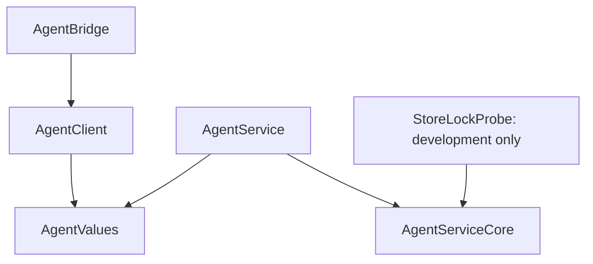
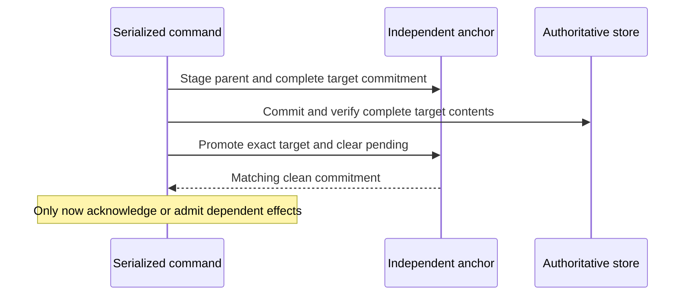

# Architecture

This foundation separates public contracts from service authority. Its source and synthetic models establish a place to implement authorization, encrypted seed persistence and continuity. Production XPC, Keychain, database, Bitcoin Cash engine, networking, owner authentication and MCP adapters remain absent. Both shipping executables report unavailable rather than constructing a partial live runtime.

## Module ownership

These arrows are the current target dependencies. `AgentValues` and `AgentClient` are public library products. `AgentServiceCore` has no library product and exposes no engine access through either public library. `StoreLockProbe` is a development product and must not enter the installed artifact set. There are no Wallet implementation, OpalBase or MCP SDK dependencies in this slice.

The eventual runtime may use supported public Bitcoin Cash APIs internally. Protocol and platform frameworks belong in their adapters. Wallet owner controls consume the public client and values; they do not reconstruct service accounts, open service storage or synchronize the same wallet independently.

## Authority and authentication

The service is the intended single authorizer and writer for a dedicated agent wallet. Its seed, wallet identity, wrapping key, continuity anchor, database and operation history must remain separate from personal Wallet state. Bundling the executables with Wallet does not transfer that authority to the app or bridge.

| Principal | Required production evidence | Permitted role |
| --- | --- | --- |
| Owner | Expected Wallet code identity on a separate owner interface, correct user context and the required fresh owner authentication | Setup, grants, policy, exact-payment approvals and purpose-scoped recovery. |
| Integration | Expected bridge code identity plus possession of an owner-issued credential | Only the current grant's wallet/account/network/capability scope. |
| Service | Expected service code identity verified by every native client | Authoritative decisions and retained service state. |

Code identity is reciprocal and tied to the expected executable's designated code requirement; a matching Team alone is insufficient. The separate [deployment dossier](Deployment.md#reciprocal-peer-verification) records the required peer relationships. The internal core uses injected peer evidence to model authorization; this is not evidence that an operating-system XPC connection has been verified.

Wallet is the trusted human-control deputy. Its signature alone does not prove fresh human consent. Integration credentials cannot enroll, revoke, change policy, approve payments or disclose recovery material, including through a malformed owner request. Launcher paths, parent-process names, display names, grant IDs, MCP metadata and claimed roles supply no authority.

The proposed enrollment protocol delivers one cryptographically random 256-bit bearer credential once through the authenticated owner channel, after its verifier and grant are committed. A lost delivery requires replacement through owner rotation, not redisclosure by grant ID. The chosen host explicitly supplies the credential to the bridge environment; the bridge has no general credential lookup. Host storage and same-user credential theft remain security limits.

Sessions bind the verified connection, derived principal, credential generation and wallet recovery generation. Every call, sensitive result and future relay admission rechecks current scope, expiry, revocation and generations. Reconnection authenticates again. Rotation preserves the integration's request namespace while invalidating old sessions; recovery disables copied credentials and active approvals. Unknown and unauthorized operation identifiers must not expose another principal's records.

The source `ServiceAuthority` routes enrollment, rotation and revocation through serialized continuity transactions. It checks the permitted account/capability inventory before enrollment and returns newly issued credentials only after the modeled handshake completes. Rotation and revocation invalidate affected unsubmitted work and active consent. Authentication and retained-result access use the same serialized boundary; they cannot bypass restricted or incomplete-history state. Commands whose complete canonical state is unchanged project their result under the same lock without authoritative writes. First observed expiry changes that state and is retained before an expired result is projected, including a failed authentication or rotation. Restart and an earlier clock cannot revive a grant whose expiry was already observed; this does not claim a trusted wall clock before that observation. These operations use injected stores and peer/authentication evidence, not production identity or persistence adapters.

## Seed protection

The source encryption boundary accepts an injected wrapping-key state and supports only AES-256-GCM protection. A plaintext profile tag remains decodable so unsupported input can be rejected; configuring plaintext rejects both save and restore. Both directions enforce encrypted mode and bound wallet context; unexpected metadata, plaintext payloads and authentication failure cannot downgrade to plaintext. A present encrypted payload with a missing wrapping key requires recovery, not replacement-key generation.

The production proposal is a service-only Data Protection Keychain wrapping key and CryptoKit AES-GCM seed encryption, with fresh nonces and authenticated format/identity context. Apple documents [AES-GCM encryption and authenticated decryption](https://developer.apple.com/documentation/cryptokit/aes/gcm). A matching key may decrypt a seed; it cannot establish that the operation journal is current or complete. Keychain and signing prerequisites remain proposed in [Deployment](Deployment.md#keychain-and-storage-boundary).

This is an encrypted hot-wallet profile. A compromised service holding signing authority is outside the protection supplied by application approval policy. No hardware isolation from that service is claimed.

## Continuity and the effect barrier

The continuity model separates the authoritative store from an independently retained anchor. A local exclusive lock prevents simultaneous cooperative writers of the same store. The lock file is retained rather than unlinked on release, so competing processes continue to address the same lock identity. This does not fence a copied wallet, another device or another holder of its seed.

The anchor binds installation, wallet, generation, commit identity and commitment-format version. It retains the committed complete-state commitment, at most one pending target and a recovery latch. The modeled commitment covers every defined authoritative row kind, including retained grant history, request bindings/tombstones, payment evidence and account gates. This does not yet establish a complete production Bitcoin Cash schema or durable backend. Ordinary model commands cannot erase an existing unresolved liability or its gate, overwrite recorded evidence, or clear an observed-expiry flag. New observations may be appended; validated liability resolution is outside this slice.

The production contract requires read-back for ambiguous durable writes and complete-content verification before promotion. An unresolved pending target, mismatch or ambiguous outcome quarantines the wallet and blocks dependent effects. Temporary key inaccessibility reports unavailable; it is not evidence of deletion. Synthetic fault injection validates model transitions, not Keychain/database durability under process termination or power loss.

## Recovery and retained liabilities

Recovery first durably latches a stable recovery identity and target generation. It selects a baseline only by recomputing complete contents that match an independently endorsed committed or pending state. A pending parent may qualify because the unpromoted command could not have passed the effect barrier. Recovery enters a new restricted generation, preserves liabilities and history, and disables copied grants and approvals.

| State | Allowed progression |
| --- | --- |
| Quarantine / recovery required | Owner-authenticated inspection and qualified recovery; no integration authority or spending. |
| Restricted, coverage complete | Separate owner enablement may be considered; unresolved account liabilities keep their gates. |
| Restricted, history incomplete | Public discovery only; no spending, enrollment or payment approval. |
| Enabled | Current policy applies; enrollment and each required payment approval remain separate decisions. |

New-store integrity cannot prove lost-history completeness. In incomplete recovery, retain the original independent proof references outside the replacement database so a later complete archive can qualify. Synchronization, owner acknowledgment and another generation cannot manufacture missing requests, signed bytes, tombstones or liability coverage.

Service-authority construction completes a serialized startup barrier before exposing clients. A clean matching store preserves request identity/results, current grants and possible liabilities while durably invalidating modeled unsubmitted requests/payments and their active approvals. Failed invalidation exposes no service authority. Possibly relayed exact bytes, consumption receipts, gates and issuance evidence remain retained; no process-local reservation is recreated. There is no payment execution, signing, broadcast or automatic relay implementation in this foundation. [Deployment restoration limits](Deployment.md#restoration-and-migration-limits) define what remains unsupported.
