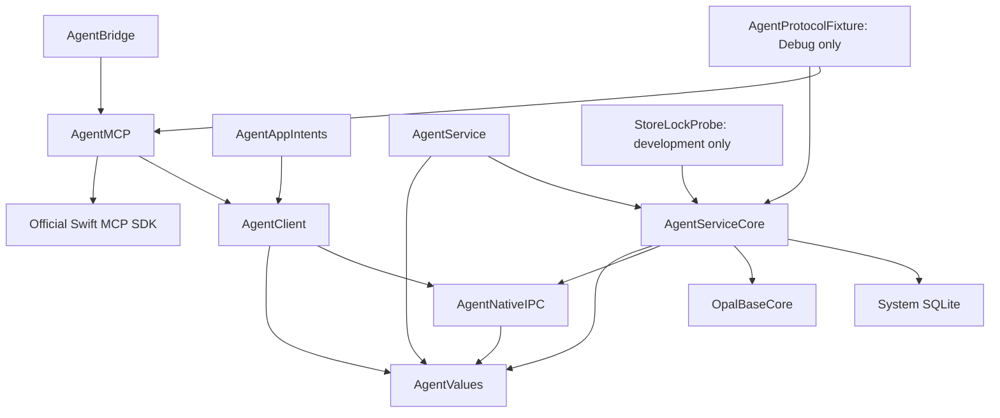
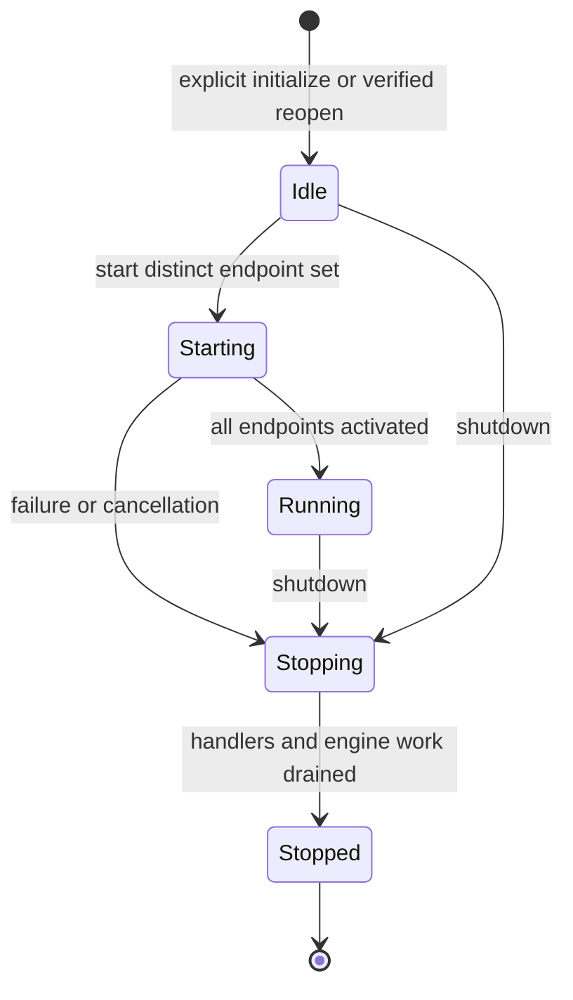
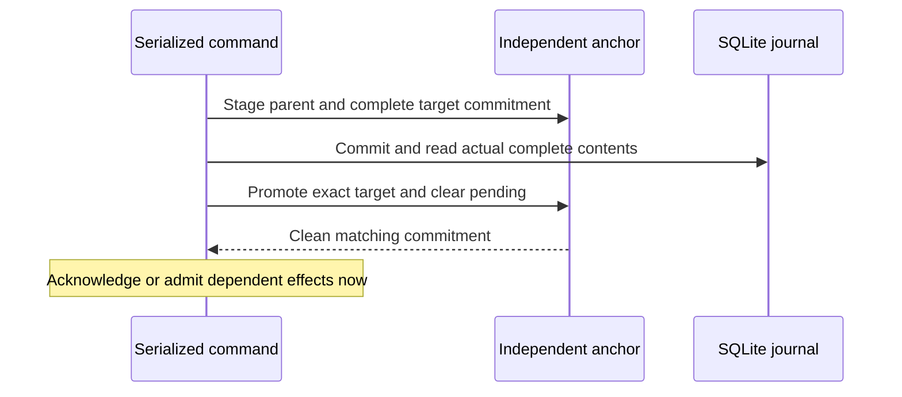

# Architecture

The package separates public values/client access from the internal wallet authority. The source engine uses real SQLite and public ordinary-BCH Base APIs with injected external boundaries. Native XPC source boundaries, a thin MCP adapter and a Mac Apple automation adapter are present. Internal service Keychain adapter source is present but is not assembled into shipping startup. This package supplies no qualified signed composition or installed lifecycle; Wallet owns its application UI. Ordinary native construction is unavailable without trusted qualified prerequisites; shipping entries never select a synthetic or weaker runtime.

## Module and runtime ownership



These are the primary source dependencies; `Package.swift` records the complete target graph. `AgentServiceCore` has no library product. Public clients receive no Base plans, private accounts, descriptors or signing authority. The ordinary-BCH Core product excludes Base's optional privacy integrations; package resolution and actual compilation/linking are distinct evidence. `StoreLockProbe` and all fixtures are excluded from installed artifacts.

`DurableWalletStore` owns the same-store writer lease, SQLite journal and continuity coordinator. The coordinator retains the lease even if a caller releases the wrapper. Startup invalidation finishes before integration authority becomes available. The generic injected-anchor initializer retains its authenticated owner recovery facade after a failed continuity check. The explicit custody `reopen` factory instead returns no composed runtime when its identity, key or startup checks fail; separately composed owner-recovery APIs remain unchanged. Each store configures and retains one payment engine and one receive engine; a second configuration fails rather than creating another local relay slot. The shipping entries do not yet construct this composition.

## Internal service lifecycle

`ServiceAssembly` owns one terminal lifecycle around the strict durable store. Explicit new-store initialization exposes only owner provisioning until creation succeeds; the same store then supplies one authority, payment engine, receive engine and capability dispatcher. Reopen verifies existing custody and finishes startup invalidation before endpoint startup. A trusted asynchronous effect factory receives the exact owned coordinator, vault and verified custody to build the existing Base adapter. It runs once per assembly; no second store or client custody access is needed. Custody and lifecycle state are rechecked after binding, and shutdown joins a binding that is still in progress. A failed binding remains failed for that assembly; it selects no replacement root or automatic retry. Integration authentication still requires separate owner enablement and enrollment. No missing or failed reopen selects a new root, identity, key or fresh initialization.



The owner, MCP and optionally configured Apple integration hosts receive separate typed handlers. Admission opens only after the complete endpoint set activates; a partial startup closes admission and invalidates every constructed host. Each accepted server-selected connection receives an opaque assembly-local handle. Peer identity, endpoint role and integration profile are checked independently of request contents. Physical native disconnection synchronously invalidates the same owner proof token before queuing actor bookkeeping; task cancellation alone supplies no revocation. Shutdown invalidates owner contexts and all connection handles. A new reopened assembly retains durable grant/request identity but cannot accept an old runtime handle; shutdown does not revoke persistent grants.

Reopened startup and explicit trusted host wake share one retained payment-continuation job for existing reconciliation and bounded retry policy. Polling does not start continuation.

Shutdown is terminal and idempotent. It closes admission, invalidates endpoints, awaits admitted handlers, drains both effect owners and only then releases its store. The engines retain preparation, relay startup, transport-result and receive tasks, including a handoff that returns while shutdown is in progress. Already entered boundaries may record their factual completion; later effect stages do not start after engine shutdown begins. Caller cancellation does not truncate drainage or establish that a remote effect never occurred. An uncooperative boundary keeps shutdown pending and retains the writer lease. No timeout clears requests, reservations, signed bytes, admission evidence or ambiguous liabilities. Reopening requires a new explicitly selected assembly after shutdown; the stopped instance never restarts.

Native hosts use these same handlers while retaining qualified-deployment, exact signed-peer and same-user checks. Listener closure excludes a racing final connection insertion. Handler references do not retain the assembly, and discarding the assembly invalidates its hosts; callers use explicit awaited shutdown for proof of drainage. Injected hosts test lifecycle and typed dispatch without constructing real listeners. Shipping startup remains unavailable, and this internal composition does not qualify protected custody, signed IPC or installed lifecycle.

Wallet remains the trusted owner-control deputy and must never reconstruct the Agent wallet, synchronize it independently or open its storage. Its personal wallet security and key namespace remain separate.

## Public capabilities and service dispatch

`AgentValues` declares typed requests and safe results for the twelve integration methods below. `CapabilityRequest` uses one service envelope (`protocolVersion`, `method`, `parameters`), with its version taken from `ServiceStatus.currentProtocolVersion`; this version is separate from MCP negotiation. Request decoding rejects unknown wallet-command fields, including nested selectors, and validates explicit network, opaque IDs, request-key grammar and pages of at most forty entries. Swift values carry exact integer satoshis. The MCP adapter uses exact decimal integer strings at its JSON boundary; UInt64 provenance and revision counters also remain decimal strings. [MCP](MCP.md) owns the wire contract and bounded profiles.

`CapabilityClient` accepts a separately injected `CapabilityTransport`, checks response version/method and supported context/shape invariants, and defaults to `UnavailableCapabilityTransport`. The existing status-only client is unchanged. The clients check transport values; the internal `CapabilityService` dispatches against the payment and receive engines under a trusted connection/session. These typed wrappers do not authenticate a peer, authorize a grant, verify chain evidence or approve a payment; their injected native transports perform the connection handshake. The bridge exposes static tool discovery and strict dispatch; its default client remains unavailable. Native transports require an explicitly supplied trusted deployment provider and never start a live service themselves.

| Integration method | Required service scope | Request/result direction |
| --- | --- | --- |
| `list_wallets` | `read` over explicitly authorized accounts | Bounded authorized wallet identities |
| `list_accounts` | `read` | Explicit wallet/network and bounded account identities |
| `get_balance` | `read` | Explicit account and retained balance observation |
| `list_transactions` | `read` | Explicit account, stable cursor and bounded transaction projection |
| `list_utxos` | `read` | Explicit account, stable cursor and bounded UTXO projection |
| `get_sync_status` | `read` | Cached observation/status without starting synchronization |
| `synchronize_account` | `sync` | Explicit keyed effect and pollable operation identity |
| `create_receive_request` | `receive` | Explicit keyed allocation and retained operation identity |
| `prepare_payment` | `prepare` | Keyed address/amount/constraints and immutable payment preview |
| `submit_payment` | `submit` | Existing immutable operation and current submission state |
| `get_operation` | `read` plus originating-principal visibility | Operation identity or retained effect key; observational lookup |
| `cancel_operation` | `cancel` plus originating-principal visibility | Cancellation only while provably unsubmitted |

The service supplies authorized discovery, cached public projections and durable generic sync/receive handling. A missing snapshot is explicit unavailable data; synchronization placeholders have no observation. Receive results distinguish pending, allocated and closed. Payment results distinguish historical closure reason from the current restriction, liability, blocker, evidence support/revision and admission count. UTXO reservations reveal an operation ID only to its current origin grant; other reservations remain opaque. Observations carry provider, view, tip, sequence and generation. A trusted assembly effect binding supplies the existing cached-facts readiness closure, with the same unavailable default. Runtime readiness is separate: retained freshness cannot establish current key or provider availability. A trusted captured-facts projection may report runtime readiness; its default is unavailable and it cannot open custody or refresh chain state.

Final result disclosure rechecks the current peer/session, connection binding, generation, account scope and origin under the continuity serializer, including after asynchronous engine calls. Integration and grant identities remain distinct; credential rotation retains the original namespace without giving a newly enrolled grant access to an old grant's history. Unknown and foreign operation lookup share the same unavailable error. Command responses use their own command scope, including cancellation without an additional read prerequisite. Safe errors contain a fixed code rather than internal error descriptions or journal payloads. Cached reads and polling do not synchronize, select inputs, allocate addresses, open seed custody, sign, reconcile or relay. They may durably retire newly observed expired authority and invalidate its unsubmitted work; unchanged reads produce no authoritative write.

The public preparation request carries address text. The service validates its network and normalizes it to a supported BCH locking script with Base before entering the internal engine. The MCP adapter must not acquire engine access or duplicate that normalizer. The client cannot prove address-to-script correspondence; raw address-text equality must not reject an equivalent supported encoding when retrying a retained normalized request.

`OwnerControlClient` and the internal `OwnerControlService` use a separate typed endpoint, absent from `CapabilityCall`. It covers custody setup/export/seed restore, journal recovery through service-cataloged opaque source handles, public discovery, enablement, enrollment/rotation/revocation, approval policy, individual preview approval/rejection and one-admission signed-byte recovery relay. No caller supplies a file path, canonical root, role or authentication flag. Seed and one-time credential material are non-Codable owner values with redacted descriptions and reflection; integration results never contain them. Enrollment persists its verifier before one-time delivery, so a lost delivery requires replacement by rotation rather than credential lookup.

Verified owner peer/connection authority permits status, recovery metadata, account discovery, bounded payment activity, payment status, preview/relay review contexts and historical relay receipts without invoking human authentication. These reads cannot act as consent for any effect. Custody reads report present-but-unverified metadata without opening a key. Every other owner call requires a fresh proof from an explicitly injected trusted consent provider. A challenge binds connection, nonce and action purpose; every sensitive call also binds its canonical request commitment; exact payment actions bind the reviewed context. The proof is rechecked at engine authorization and after asynchronous work, including connection invalidation and age. Native connection code configures exact peer requirements and a trusted Wallet consent callback, but no production qualifying provider or Wallet authentication UI is supplied. Injected proofs and wire tests remain source/synthetic evidence only.

Ordinary approval/rejection uses a full safe preview context with wallet/account/network, current generation/policy and origin credential identity. The engine compares the service commitment to the full retained preview inside the same payment transaction. Signed-byte relay uses a different context containing the stored transaction digest, current generation/policy, evidence revision and account liability commitment. Its retained key produces a historical receipt; polling or replay cannot admit another relay. Secret export compares current custody and generation after asynchronous derivation, and receipts project the retained command and current payment in one serialized observation.

## Principals and retained request identity

| Principal | Required production evidence | Authority |
| --- | --- | --- |
| Owner | Exact expected Wallet identity and correct user; fresh purpose-scoped human proof for commands that require it | Observational owner reads plus separately authenticated setup, enrollment, rotation/revocation, policy, approvals and recovery. |
| MCP integration | Exact expected bridge identity plus a current MCP-profile owner-issued 256-bit bearer credential | Current wallet/account/network/capability scope only. |
| Apple integration | Exact expected Wallet integration peer plus its separate current Apple-profile credential | Current integration scope only; no owner selectors or consent callback. |
| Service | Exact expected service identity verified reciprocally | Sole authorizer, writer, signer and relay coordinator. |

The internal core consumes injected peer and authentication evidence. This proves decisions over evidence. Compiled native source configures operating-system requirements before activation; evaluated signed identity enforcement remains unqualified. [Deployment](Deployment.md#reciprocal-peer-verification) owns the required signed peer relationships. Team-only matching, launcher metadata, paths, grant IDs, MCP metadata and claimed roles provide no authority. A signature alone supplies no fresh human consent.

Enrollment commits the verifier and scope before one-time credential delivery. Lost delivery requires rotation, not secret lookup. The chosen host explicitly injects its credential into the bridge environment; the shared bridge cannot retrieve another integration's secret by grant ID. Host storage and theft by arbitrary same-user processes remain explicit limits.

Sessions bind connection, integration peer profile, principal, credential generation and wallet generation. `NativeIntegrationTransport.authenticate()` completes the existing hello/credential handshake without an account read or new capability. A reused transport may reuse its completed session; an independent current-credential check needs a freshly constructed fixed-profile transport. The host must then recheck its retained enrollment binding and known-unlocked state in its own serialized context after awaited work. Retained client metadata or lazy client construction alone cannot establish current service authority. Every operation, sensitive result and relay handoff checks current authority. Rotation preserves the stable integration namespace and authorized historical lookup while invalidating old sessions and unsubmitted work. It does not rebind a possibly relayed operation to the new credential generation: that operation retains its bytes, admission count and gate, and further relay requires a fresh exact-byte owner command. Rotation never replenishes the ordinary allowance. A newly enrolled grant cannot disclose a revoked grant's historical operations merely by reusing its integration label. Recovery disables copied credentials and approvals.

Payment, synchronization and receive keys are 32 lowercase hexadecimal characters, retained by the client before sending. The namespace is wallet, stable integration, effect kind and key; account/network and every supported caller field belong to a versioned exact payload. Malformed keys are rejected. The internal payment API accepts a validated locking script and integer satoshis; the authenticated service facade owns address/network normalization before that boundary, while the MCP adapter maps strict external values to the public client. Equal retained requests reuse one operation; changed payloads conflict without another effect. A new key is a new intention, including a legitimate repeat payment to the same recipient and amount. Completion, expiry, rotation and restart never recycle keys. Current disclosure checks also apply to retained results and conflicts.

### Peer profiles and retained encoding

The native `integration` channel remains bridge-only. The optional `appleAutomation` channel pins Wallet's exact identity and exports only the existing integration interface. It is a separate Mach service in the same authority, not another wallet writer or an owner-interface alias. `NativeDeploymentPolicy.appleIntegrationMachService` defaults to absent; the Apple client and listener refuse construction until an explicit qualified deployment configures that distinct service and peer. A valid credential on the wrong peer/channel fails. A message cannot select an owner role or another integration's credential.

`IntegrationPeerProfile.mcp` is the default for existing enrollment callers and missing legacy stored profiles. MCP canonical grant and owner-wire encodings omit the default field, preserving old bytes and complete-state commitments. Explicit null, unknown and conflicting profiles fail. Apple grants encode the authoritative profile and the same existing SHA-256 credential verifier as `profileCredentialDigest`, omitting the legacy required `credentialDigest` field. This closed row form forces an unsupported reader to refuse the store rather than reinterpret Apple authority as MCP. Profiles cannot change on an existing grant; rotation and restricted recovery preserve them.

Canonical state format 2, anchor format 1, SQLite schema 1 and native protocol 1 remain separate unchanged domains. Original-code SQLite/state/anchor/archive and MCP enrollment-frame fixtures protect the promised legacy representation. New-profile state uses the ordinary staged-anchor/database/read-back/promotion handshake. An unsupported binary must refuse new-profile storage or messages before effects; it must not reset history, drop a profile or restore authority as a compatibility fallback. These source/synthetic proofs do not establish installed upgrade or signed-XPC interoperability.

Apple automation uses a dedicated owner-enrolled grant, initially read-only. Scope expansion requires explicit replacement enrollment with a fresh integration ID and revocation of the old grant. Same-scope credential rotation preserves its namespace; replacement and recovery cannot transfer old handles or receipts. All Apple automations share this integration. Its device-local credential belongs to the Wallet host, separate from the service-only seed key/anchor, and is never an entity, intent parameter or index field. No live credential-storage or signed-host provider is supplied here. If spending is enrolled, the existing autonomous default, later-deposit exposure and optional service approval policy apply unchanged.

## Seed and custody boundary

`BaseSeedAccountProvider` uses BIP39, an empty passphrase and BCH BIP44 coin type 145, account zero, on explicit mainnet, testnet or chipnet. `WalletSeedVault` persists an AES-256-GCM protected mnemonic envelope plus its bound wallet, network, derivation profile, account ID and public descriptor. Save and restore enforce encrypted mode; wrong metadata, plaintext, authentication failure or mismatched derived identity cannot downgrade protection. A missing wrapping key never causes replacement over existing ciphertext.

The signing-account factory opens the verified encrypted envelope and reconstructs the actual fixed-profile Base account, independently checking its ID and public descriptor. A separate descriptor-only factory supports public discovery without wrapping-key access and cannot sign. Keys are injected and checked before key-dependent Base work and the final handoff. New-wallet creation establishes restricted, coverage-complete storage with no grant. Separate authenticated enablement requires the matching available wrapping key; enrollment is another command. Seed-only restoration preserves surviving liabilities and original proof references but cannot manufacture missing journal coverage. When the original complete journal still matches an independent endorsement, owner seed recovery qualifies that unchanged baseline before replacing its ciphertext. Recovery first disables copied authority in restricted storage; a separate restricted custody-rewrap handshake changes only the same verified wallet/network/profile/account/descriptor's encrypted payload while preserving coverage, provenance and every retained row/gate. An initially missing/unavailable injected replacement key fails before reset. The later current-key check may instead leave the already-restricted baseline with its old ciphertext; the source never creates a replacement key automatically. A crash between phases leaves restricted old ciphertext, while interrupted rewrap follows ordinary quarantine/read-back recovery.

`KeychainWrappingKeySource` implements the existing read-only key seam for an already provisioned 256-bit wrapping key. It requires explicit wallet identity and an exact configured access group; it supplies no production prefix or default-group fallback. The reader never provisions, generates, rotates or deletes keys. Missing results never trigger regeneration, including when encrypted custody already exists.

`KeychainNewWalletCreation` is an explicit internal service composition for owner-authorized new wallets. `DurableWalletStore.initializeNew` exclusively creates a new service-selected storage directory, retains one installation/wallet scope in `custody.scope`, and supplies its actual SQLite journal and writer lease to this composition. The scope record is a strict versioned ASCII locator containing only canonical installation/wallet UUIDs; the access group remains trusted configuration. Any existing directory, including an interrupted prefix without complete metadata or custody, refuses fresh initialization. The context constructs the matching key reader, anchor, coordinator and vault together; clients supply neither storage identity nor a vault. `OwnerControlService(store:)` binds owner commands and authority to the same durable coordinator and resolves that store’s single configured payment engine when needed, including after initial creation. The existing explicit creation initializer remains supported. Default composition and shipping startup do not select either path.

Creation checks owner authorization and absent database, anchor and wrapping key before preparing a new seed/account asynchronously. It revalidates connection-bound consent after suspension, then rechecks freshness under the continuity serializer. Before any key generation/add the initial write must acknowledge success and exact read-back must verify the existing recovery-latch format. `KeychainWrappingKeyProvisioner` adds one 256-bit candidate without update/delete/retry, then validates exact returned metadata and byte equality before encryption uses the stored key. A duplicate, ambiguous add, failed read-back or interrupted initialization retains evidence and returns failure; another create cannot restart over its latch, key, database or ciphertext. A failure before any durable marker or key effect does not establish completed initialization. The existing handshake commits generation-one restricted/history-complete custody and clears the latch only after verification. Enablement and enrollment remain separately authorized commands. Final trusted-root selection, entitlement eligibility, native durability and installed-service behavior still require deployment qualification; injected composition proves none of them.

`DurableWalletStore.reopen` requires the same trusted, service-selected existing root, a regular existing lock file, a strict existing scope locator and existing initialized-schema SQLite; it does not create any missing file or namespace. It requires exact locator/canonical-state identity agreement, the matching independent anchor’s complete state reference and an available wrapping key, then completes startup invalidation before returning integration authority. Failed or interrupted evidence returns no composed runtime and is retained for separately designed handling. The reopened owner endpoint has neither add-only provisioning nor legacy preprovisioned creation capability. Escaped owner facades, services, authority and effect engines retain the same coordinator and lease.

The locator is not authentication authority and cannot replace the independent anchor. Isolated locator or journal substitution is refused, including a locator naming another genuine anchor. Coherent replacement of the entire directory by another intact wallet with an available matching independent anchor is not authenticated by filesystem metadata; the service-selected root is an explicit trusted composition input, never client data. The lock remains a same-inode advisory guarantee; replacing a directory or lock inode is outside that guarantee. No new trusted index, namespace discovery, migration, recovery, physical durability or installed-service qualification follows from this source composition.

The service-only item policy remains Data Protection Keychain, non-synchronizing, `AfterFirstUnlockThisDeviceOnly`, without interactive user presence. `KeychainItemOperations` separates the actual Security calls from injectable request/result handling. Shipping entries do not construct the adapters, and executed adapter tests must use injected operations. A no-match result is distinct from inaccessible or malformed data and does not prove entitlement eligibility or physical key loss. Every request uses a fresh noninteractive authentication context. Optional returned `SecAccessControl` metadata is type-checked but remains opaque; accepting its type does not prove the absence of user-presence constraints or qualify actual access behavior. Successful decryption does not prove journal continuity. Application approval policy does not isolate signing secrets from a compromised hot-wallet service. [Deployment](Deployment.md#keychain-and-storage-boundary) records the pending custody prerequisites.

## Actual journal and continuity barrier

`SQLiteJournal` stores versioned authoritative roots and normalized grants, requests, payments, attempts, evidence, closures, approvals, gates and allocations. Identity columns and uniqueness/foreign-key constraints are cross-checked against decoded payloads. Public snapshots, custody and policy are included in the root commitment. The complete canonical format is version 2; SQLite schema version is 1. Unknown formats/databases are rejected; no migration from an operational predecessor is claimed.

The writer uses DELETE journal mode, EXTRA synchronization, fullfsync and foreign keys. Each read reconstructs all rows from a separate committed read transaction. Failed COMMIT is rolled back before read-back; a writer that cannot return to autocommit is poisoned. Uncommitted connection-local rows cannot prove success. These settings and process-termination fixtures do not prove hardware power-loss durability or Keychain atomicity.

The independent anchor is outside the database rollback domain. It binds installation, wallet, generation, format and complete state, retaining a committed reference, at most one pending target and a recovery latch. `KeychainContinuityAnchorStore` reads and writes the complete anchor in a separate installation/wallet-scoped item through the same injectable Security boundary. It validates any existing item before mutation, preserving rejected metadata or contents. It preserves the existing anchor format and coordinator-owned staging/read-back protocol; its preflight does not replace post-write verification or infer rollback from a thrown write. There is no default file-backed production anchor in this package.



Ambiguous writes proceed only after actual read-back proves the exact stage. Pending/mismatched state quarantines dependent effects. Generic transitions retain immutable history and liabilities. A separate payment validator permits only the engine's named transitions, retaining exact bytes, attempts, historical evidence, closures and request bindings. All authoritative facts remain covered by the complete commitment.

## Payment execution

Preparation first retains request identity and the account gate. Base creates an unsigned reviewed template with fixed input/output order, fee and change; the service attaches a conservative preview deadline and rechecks the actual Base reservation before first admission. Approval binds that exact preview, policy and generation. Signing occurs only after readiness; canonical transaction bytes and the numbered attempt are durable before transport may begin. Retried payments reconstruct the same immutable transaction, without rehydrating process-local reservations.

| State | Effect and restriction |
| --- | --- |
| `preparing` / `prepared` | One durable account gate; unsigned Base work or retained preview. Cancellation/expiry can prove unsubmitted. |
| `pendingApproval` / `ready` | Exact owner approval when required; current grant, policy, generation and live reservation remain necessary. |
| `submitting` | Durable admission and exact bytes; transport may have begun. A crash is ambiguous. |
| `uncertain` | No proof of accepted/accounted outcome; retain account liability and identical bytes. |
| `accepted` | Relay or public evidence reports acceptance; reconciliation and cleanup still hold the gate. |
| `recoveryRequired` | Known damage requiring owner repair; no timeout unlock. |
| `closed` / `invalidated` | Proven unsubmitted outcome or evidence-based reconciled closure; retained request identity. Evidence-based closure can lose support and restore restrictions. |

```mermaid
stateDiagram-v2
    [*] --> preparing
    preparing --> prepared
    prepared --> pendingApproval
    prepared --> ready
    pendingApproval --> ready
    ready --> submitting
    submitting --> uncertain
    submitting --> accepted
    uncertain --> submitting
    uncertain --> accepted
    accepted --> closed
    uncertain --> closed
    uncertain --> recoveryRequired
    recoveryRequired --> submitting: Fresh owner command
    closed --> submitting: Invalidated evidence; fresh owner command
    preparing --> invalidated: Restart or authority change
    prepared --> invalidated: Restart or authority change
    pendingApproval --> invalidated: Restart or authority change
    ready --> invalidated: Restart or authority change
```



The diagram shows the principal routes; cancellation, expiry and affirmative first-attempt no-handoff also close unsubmitted work. Ordinary restart invalidates every unsubmitted preparation/approval because Base reservations are process-local. Admitted work retains bytes, counts and gates and resumes as uncertain when necessary.

The continuity lock orders revocation/policy decisions against each synchronous Base claim and actual transport handoff. A grant check before an async suspension is insufficient. Revocation acknowledgment prevents later handoffs under that authority and reports admitted work; it cannot recall funds already relayed. Acceptance after timeout remains evidence rather than “not sent.” Failed cleanup cannot hide a known accepted transaction. A normal unknown relay can close in the same runtime when later decisive coherent evidence arrives: Base ends the exact claim-bound local invocation, revalidates its ownership and disposes only that lease while preserving synchronized UTXOs. Timeout alone cannot trigger disposal or gate release. A genuine earlier claim-cleanup failure reports `leaseCleanupFailed` and retains the gate; the current implementation requires fresh-account restart plus positive reconciliation for that failure rather than a live repair fallback. Budget exhaustion does not prevent passive reconciliation from closing a resolved liability.

There are at most three ordinary admissions: initial, then at least 30 seconds, then at least another 120 seconds. Restart waits the full relevant monotonic delay conservatively. Reads never relay, sleeps do not cause retry bursts and no local calls overlap. A one-admission owner command has its own retained key/receipt, exact bytes and current wallet/policy/evidence/account-liability context. Consumed replay is historical and cannot enqueue another call. Owner recovery can relay one fully recorded liability while other remote liabilities remain, after the local call slot is free; it releases no restriction and replenishes no ordinary allowance.

Reconciliation binds asynchronous replies to the captured wallet generation, observation sequence and material evidence revision. Stale replies remain historical evidence only. Closure requires a complete fresh coherent view accounting for selected inputs and change, plus the exact transaction or a canonical confirmed conflicting spend. The Agent adapter verifies inclusion with Base's Merkle-proof primitive against a supplied canonical header; provider selection of the validated canonical view is an injected trust boundary, not a new SPV implementation. Missing history, timeout and lack of confirmation cannot establish non-submission. Detected loss of support restores liabilities and invalidates dependent readiness before new value selection. Source/view/tip changes detected before handoff require current evidence; external chain changes cannot be made atomic with local execution.

## Synchronization, allocation and discovery

The public `synchronize_account` and `create_receive_request` commands are durable keyed effects; cached reads remain observational. A command commits its identity and pending state before scheduling work, returns promptly and remains pollable after a lost response. Same-key replay coalesces active work and returns its retained outcome. Completed sync observations and allocated addresses remain stable; cancellation closes only pending work and a late completion cannot disclose or allocate from the cancelled request. Transient receive blockers retain pending identity for an explicit same-key retry; polling never retries. Restart invalidates incomplete sync/receive work rather than silently restarting it; a new intention needs a new key. Completed allocations/high-water remain retained.

A snapshot's `fresh` describes its observation in the recorded generation, not process-local readiness or an age policy. Cached projection marks a prior-generation snapshot stale without mutating its retained contents; explicit sync is required for a current-generation observation. Refresh tokens bind account, wallet generation and sequence so an old completion cannot replace newer public state or disclose after revocation. Owner-authenticated discovery can refresh public snapshots in trusted restricted/history-incomplete storage while leaving grants, gates, approvals and issuance evidence unchanged.

A receive branch issues distinct indices only through confirmed-history horizon plus 20, with durable high-water committed before address disclosure. Empty history has horizon -1, allowing indices 0 through 19. Mempool use and local reservation flags do not advance the bound. Same-key replay returns the original address. Change uses its own confirmed-history horizon plus one and reuses that candidate across cancelled/no-change preparations; receive history cannot expand change.

Seed discovery is conditional on supporting confirmed history remaining discoverable. Twenty unpaid addresses followed by funding index 19 remain within the default scan gap; unrestricted allocation or a funded index 20 after twenty unused entries does not. Reorg can remove a bridge to a later issued range, so retained range evidence is needed for directed recovery. Losing metadata loses proof of which unpaid addresses were issued: restricted discovery cannot silently reset high-water or promise never-issued addresses.

## Recovery and supported limits

Recovery durably latches one stable identity/target generation before selecting a baseline. Only complete actual contents matching an independently endorsed committed/pending reference establish coverage. Exact pending-parent recovery is usable because unpromoted work could not pass the effect barrier. Recovery resets into restricted storage, retains liabilities, disables copied credentials/approvals and invalidates unsubmitted Base work. Enablement, new enrollment and exact-payment approval remain separate.

| Storage condition | Supported outcome |
| --- | --- |
| Intact store and clean independent anchor | Retain valid authority, requests and liabilities; invalidate unsubmitted preparations at startup. |
| Interrupted update with exact complete proof | Owner reset to restricted, coverage-complete storage; gates retained. |
| Older backup after payment/revocation | Mismatch quarantines; old authority cannot resume. |
| Seed-only restore, lost journal or missing anchor | Fixed-profile public discovery in restricted/history-incomplete storage; no autonomous enablement or grant. |
| Later archive matching retained original complete proof | Owner reset may recover complete coverage; current incomplete-store integrity alone cannot. |

Original independent proof references survive incomplete recovery episodes. Sync, a generation change or owner risk acknowledgment cannot clear missing coverage. ThisDeviceOnly keys and anchors do not migrate. The local writer lock excludes one store's cooperative processes only; it cannot fence an old Mac, cloned seed, administrator or rollback of both independent stores. Autonomous same-seed migration remains unsupported if the old instance may sign. [Deployment restoration limits](Deployment.md#restoration-and-migration-limits) define the deferred transfer and distribution duties.

## Native and protocol composition

`AgentNativeIPC` contains the separate owner/integration XPC interfaces, exact signed-artifact policy and bounded typed wire codecs. `AgentClient` owns native connection clients; the internal core owns listener delegates and connection-bound service endpoints. Both clients pin the exact service requirement before activation. Each listener pins its channel's exact Wallet or bridge requirement, checks kernel effective user identity and derives a new physical connection context; wire role fields cannot create that context. Credential possession is checked only after a no-secret handshake. Interruption invalidates the session/context and pending consent. Owner observation uses no human proof; effects use a fresh purpose/context/nonce/connection-bound callback to the trusted Wallet deputy. A missing trusted deployment/prerequisite provider fails unavailable. No provider that qualifies production custody or signed artifacts is implemented here.

Production owner and capability endpoints call the internal `NativeServiceFrames` dispatcher. Its shared decode → admitted handler → encode path preserves the existing `NativeWire` version, request correlation, strict DTO and byte limits, safe problem mapping and separate `NativeOwnerPacket.sensitive` slot. The decoder cannot create a peer, choose a role or grant authority. Dispatch requires the actual role-specific `ServiceEndpointHandlers` and an opaque current `ServiceConnection`; integration authentication, owner consent and post-suspension validity remain enforced by the assembly and service.

Synthetic endpoint hosts can exercise that same request dispatcher against actual assembly ownership, including consent, sensitive responses, retired handles and drain/reopen behavior. Typed owner-service component tests remain separate proof and do not exercise this assembly request-frame path. Physical NSXPC capture, kernel same-user checks, signed-peer enforcement, native hello/authentication-envelope exchanges and reverse native consent callbacks remain outside the shared dispatcher. Synthetic hosts create no listeners and qualify none of those native or installed-service boundaries.

The development-only `AgentProtocolFixture` is an explicit Debug target, never a shipping configuration flag. Its ordinary runtime initializes or reopens actual `ServiceAssembly` ownership over temporary SQLite. A published, permanently disposable vector provider and synthetic Security-style item operations exercise the actual owner create, enable and enrollment boundary. The owned asynchronous effect factory constructs the real Base adapter from that exact coordinator, vault and custody; restart restores its public descriptor before continuation. Synthetic endpoint hosts expose the assembly’s separate owner and integration handlers without creating native listeners. Every SDK session opens and authenticates a current opaque service connection, and closes that admission before SDK teardown. No owner MCP tool is added. Release cannot assemble this fixture.

The owned-process fixture resumes only its capability-bound namespace and verified store/file identities. An independent append-only relay oracle records actual synthetic transport entry separately from SQLite admissions. Process scenarios compare retained request, transaction and attempt identity, exact bytes and liability gates across termination, including exhausted ordinary retry authority. Controlled stop initiates assembly admission closure before waiting for MCP shutdown and retains the writer through actual engine/transport drainage. Releasing a held synthetic fault is an explicit separate action; controlled stop and process-death scenarios remain distinct from stdin-closure checks.

Ordinary fresh CLI closure checks half-close the actual parent stdin pipe after complete SDK receive work, with either clean termination or an unterminated effectful final frame. They require completed receive identity/allocation to remain retained, no dispatch or extra allocation from the incomplete tail, and natural SDK/assembly teardown followed by child exit and reap. Bounded transport unit checks retain their separate framing proof.

Controlled owned-child closure checks half-close stdin while a synthetic relay remains held. The existing input-termination callback initiates actual assembly shutdown before the SDK can join suspended handlers. Debug control observations report `admissionClosed` after admission closes and `assemblyDrained` after actual drainage, both with phase `stdio-ended`. The callback also runs on input errors or cancellation, so those events alone do not identify OS EOF. Actual parent half-close, old-handle lookup refusal, same-inode writer retention and the independent relay oracle establish the causal boundary. The control channel intentionally stays open for post-EOF inspection and explicit relay release; later explicit close is controlled-child cleanup, distinct from ordinary CLI exit. Stop, caller cancellation, kill or cleanup is not a substitute for that proof. A local SDK disconnect with borrowed descriptors is not OS EOF, and these fixture-owned lifecycles do not change independent production-service lifetime when an MCP client disconnects.

Quarantined and restricted owner-only recovery checks use an explicitly selected minimal recovery composition with unavailable effect boundaries; an ordinary assembly reopen error never selects it. Those checks preserve their separate storage/receipt and zero-wrapping-key-read guarantees and do not claim assembly-to-MCP qualification. Temporary file-backed synthetic items and injected consent, peers, public-chain data and relay results cannot establish live Keychain durability, real network payment, native signatures, human authentication, installed lifecycle, host-session interoperability or distribution readiness.

## Owner discovery without integration authority

A fresh Wallet owner client first reads status to obtain the authoritative wallet/network, then calls owner-only `listAccounts(wallet)` to obtain the fixed-profile custody account before enrollment. The directory reports current wallet generation and at most forty account scopes (the supported profile has one); it never derives keys or opens custody during the read. Empty status invents no wallet or account, while trusted restricted state can expose its real account without enabling spending. Untrusted/quarantined state cannot supply a trusted directory.

Owner-only `listPayments(wallet,page)` returns safe payment projections from one serialized current snapshot, including preparations, pending approvals, terminal history and unresolved liabilities. Wallet can therefore find a pending selector and request its exact preview review without borrowing an integration credential or knowing an engine row. A page contains at most forty items sorted by operation identity. Its opaque `snapshotID` commits to the complete current state reference; it is not a fabricated monotonic counter. Cursors bind the wallet, network, generation, snapshot commitment and offset. Unchanged state gives stable pages; any changed snapshot rejects the old cursor as stale and requires a fresh first page. These observational queries neither prompt for human consent nor synchronize, allocate, open keys, approve, sign, reconcile or relay. Final owner peer/connection checks still govern disclosure.

Wallet composes native clients through the public `AgentClient` and `AgentValues` imports. The client module provides narrow public aliases for `NativeWalletConsentProvider`, `NativeConsentChallenge`, `NativeConsentProof`, `NativeDeploymentProvider`, `NativeDeploymentPolicy`, `NativeSignedIdentity` and `NativeChannel`; a consumer does not import native wire helpers to implement consent or deployment prerequisites. Default construction remains unavailable. External consumer compilation establishes this source boundary, while the deployment matrix still governs native runtime qualification.

## Mac Apple automation adapter

`AgentAppIntents` is a Mac-only package adapter over `AgentClient` and `AgentValues`. It contains no service engine, database opener, key provider, scheduler or owner client. The main application includes `AgentAutomationPackage` in its own `AppIntentsPackage` and explicitly registers `AgentAutomationDependency` before a query or action executes. Every intent and entity query selects the main application. The default dependency is unavailable; discovering the package or decoding an entity supplies no authority. Apple documents [package inclusion](https://developer.apple.com/documentation/appintents/appintentspackage) and [main-process intent/query execution](https://developer.apple.com/documentation/appintents/intentexecutiontargets/main); supported APIs do not establish the host's runtime composition.

The host supplies three narrow collaborators: `AgentAutomationAccess` for the dedicated Apple integration session and privacy guard, `AgentAutomationRequestStore` for retained local caller identity, and `AgentAutomationReviewNavigator` for a selector-only foreground handoff. Access must authenticate current service authority, then atomically validate the current credential-bound enrollment and known-unlocked facts in host-owned serialization after its final suspension. Constructing a transport or consulting a previously authenticated cached session is insufficient. This is a host contract awaiting its own native qualification, not a claim that App Intents authentication policy proves the Mac is unlocked or grants payment approval.

### Retain before effect

New Agent Request creates local identity only. Before an effect can be requested, the host must durably retain a fresh random request key, independent opaque handle, wallet/network, integration and grant identity, wallet generation, effect, account, exact typed caller fields, defaults and absolute expiry. The credential generation is checked in the current session but is excluded from the persistent owner identity so authorized credential rotation can preserve handles. No credential or authoritative service state belongs in this file. A distinct New invocation means a distinct intention; recipient and amount are not duplicate-payment identifiers.

Synchronization, receive and preparation actions require the retained handle and replay its original command under that command's own scope. Successful replies are validated and mapped directly, without requiring an additional read permission or scheduling a second operation. The service owns normalization, idempotency, operation state and every effect. A once-filled local operation selector is correlation metadata, never a replacement state machine. A storage or reply failure does not generate another key or prove that the service did nothing.

Resume is an observational `get_operation` lookup using the original effect/account/key and requires read scope. It can recover an operation selector after response loss. Explicitly repeating the original effect action instead uses that effect's original command scope and key. Submit and cancel require an already retained exact selector; they do not infer one or silently add a read. A completed synchronization replay remains the original result; a fresh observation requires an explicit New synchronization intention. Cancellation of host execution does not cancel a service operation.

Rotation may retain the same local owner identity while current credential checks and the service's original-operation rules continue to apply. Replacement enrollment uses a fresh integration and grant identity. Recovery changes wallet generation. Neither silently transfers old handles, receipts, approvals or relay allowance. Surviving records remain retained; a bounded recent picker does not delete older identities. Missing or corrupt local metadata fails unavailable and cannot reconstruct a lost key from the same human intention.

### Capability parity and disclosure

| Existing service method | Apple adapter mapping |
| --- | --- |
| `list_wallets` | One transient wallet page; no persistent wallet picker. |
| `list_accounts` | One bounded neutral account directory. |
| `get_balance` / `get_sync_status` | Cached account inspection/status; no synchronization. |
| `list_transactions` / `list_utxos` | Explicit bounded cached history or advanced unspent-output page. |
| `synchronize_account` / `create_receive_request` / `prepare_payment` | Deliberate execution or same-key replay of the matching retained request. |
| `get_operation` | Read-scope Resume of the retained key. |
| `submit_payment` / `cancel_operation` | Explicit command on the retained operation selector. |

Neutral account, receive and payment references and the auxiliary local request handle are resolved only under the current bound integration. Query execution independently requires read scope, authenticated current authority and the privacy guard; it does not borrow an owner directory or create an account effect. Credential and privacy checks for queries must be noninteractive; unavailable or unknown facts return no references instead of prompting or navigating. At most forty references are returned. Serialized labels, networks and identifiers supply no authority. Same-account access does not disclose another integration's operation journal.

Financial outputs conform to [`TransientAppEntity`](https://developer.apple.com/documentation/appintents/transientappentity), have harmless empty initialization and empty main-app re-resolution queries. Their typed fields carry exact satoshis, network, actual state, freshness and uncertainty; unknown observations remain absent. On the supported 64-bit Mac, numeric framework properties use checked exact `Int` conversion from service integers. No amount passes through floating point or a display string. Rendering adds no service activity, and a dialog or snippet is never the sole result.

This adapter supplies no `IndexedEntity`, proactive financial donation or Mac preconfigured-shortcut provider. Main-app package discovery and neutral queries are separate from proactive indexing. Omitting app-initiated donation does not prove that the system or downstream shortcuts retain no prior execution/result data, and revocation cannot retract those copies. Actual extracted metadata must independently confirm all declared intents, parameters, main-app queries and transient result types; compilation alone cannot prove system discovery or privacy behavior.

Open Wallet Review validates the current Apple integration's retained payment selector and returns only a matching route acknowledgment. The acknowledgment means navigation was accepted, not that review, authentication, approval or submission occurred. Wallet independently resolves owner context at its foreground destination, including separately supplied MCP-origin selectors through its owner router. No owner preview, receipt, reusable consent proof or cross-grant result returns to the invoking automation. Existing autonomous spending and optional exact-payment approval remain service policy.


## Diagnostic observations

`AgentServiceCore` and `AgentMCP` use OpalDiagnostics through internal closed vocabularies. Their callers supply only finite classifications and fresh local attempt tokens, never arbitrary strings, errors or diagnostic field arrays. Every Agent field is public-safe before it enters Diagnostics; private-field redaction is not an input-sanitization substitute. Seeds, keys, credentials, principals, wallet/account/grant/operation/request/transaction identifiers, amounts, addresses, scripts, payloads, digests, paths, endpoints and arbitrary error descriptions are excluded. Internal payment row IDs are used only to compare retained states locally and never passed to Diagnostics. Observation does not add a journal schema, durable audit trail, authorization fact or recovery proof.

| Category | Event | Public fields and meaning |
| --- | --- | --- |
| `agent.authorization` | `authorization_denied` | `reason`: closed mapping of the actual authorization guard refusal. It does not assert that a surrounding command made no durable change. |
| `agent.journal` | `barrier_verified` | No fields. The complete database/anchor handshake passed actual read-back, including any ambiguous thrown writes. It does not mean that later projection or acknowledgment succeeded. |
| `agent.journal` | `trust_unavailable` | `reason`: `recoveryRequired`, `keyUnavailable` or `storageUnavailable` at the existing trust check. No arbitrary storage error is inspected. |
| `agent.recovery` | `recovery_completed` | `history`: `complete` or `incomplete`; `path`: `reset` or `resumed`. The final recovery-latch clearing has passed verification; complete history still has its existing evidence meaning. |
| `agent.payment` | `payment_transition` | `from_state`: a `PaymentDisposition` case or `new`; `to_state`: a `PaymentDisposition` case. One observation per distinct changed state pair in a verified ordinary transaction/startup batch, without row identity, count or within-batch causal ordering. |
| `agent.mcp` | `tool_failed` | `stage`: `method`, `input` or `result`; `reason`: a finite `ServiceProblemCode` case. Output-budget and unknown failures map to `unavailable`, without claiming the service itself failed. |
| `agent.mcp` | `transport_failed` | `reason`: `connection`, `incompleteFrame`, `read`, `frameSize`, `emptyFrame`, `capacity`, `send` or `write`, at an existing bounded transport refusal/termination. |
| `agent.mcp` | `protocol_rejected` | `reason`: `parse_error`, `invalid_request`, `method_not_found`, `invalid_parameters` or `request_failed`. Recorded after the rejection's existing output handoff succeeds; peer receipt is not established. |
| `agent.service` / `agent.mcp` | `assembly_unavailable` / `bridge_stopped` | No fields. The executable reached its existing fixed-error path. |

The continuity owner emits verified payment observations under the same serialization boundary after the handshake and before projection, which may still throw. Commands that leave payment dispositions unchanged, including unchanged replays, emit no new transition. An attempted write that throws is ambiguous until existing read-back proves its result; there is no diagnostic “commit failed” inference. Recovery-reset invalidations use `recovery_completed`, not exhaustive per-payment transition events. Process loss, disabled capture, filtering and bounded eviction can omit observations; missing events cannot prove that a write, relay or payment did not occur. The authoritative journal and existing reconciliation/recovery procedures retain their roles.

Every emitted Agent observation explicitly selects a fresh random local `TraceID`; verified journal/payment observations within one transaction share a fresh attempt token. Tokens are not derived from retained identities and do not inherit a caller-supplied task trace. They have no authority and are not persisted in Agent’s authoritative journal or transmitted in its wire contracts; retained diagnostic records include them. They do not propagate across XPC or stdio. No end-to-end lower-library correlation is promised.

Only executable composition or an embedding host may configure Diagnostics. `AgentService` selects exactly `agent.service`, `agent.authorization`, `agent.journal`, `agent.recovery` and `agent.payment`; `AgentBridge` selects exactly `agent.mcp`. Both leave buffering and routing disabled. Libraries never configure/reset the runtime or clear a host capture. Synthetic qualification can use an isolated task-local scope, copy the retained records inside that scope, and leave routing disabled:

```swift
let capture = OpalDiagnostics.Configuration(
    subsystem: "com.58opals.agent.tests",
    categoryFilter: .enabled(["agent.authorization", "agent.journal", "agent.recovery", "agent.payment", "agent.mcp"]),
    bufferPolicy: .enabled(capacity: 40),
    routingPolicy: .disabled)
try await OpalDiagnostics.withConfiguration(capture) {
    try await exerciseSyntheticOperation()
    let records = OpalDiagnostics.recentRecords
    // Inspect/copy records here, after owned asynchronous work has completed.
}
```

`exerciseSyntheticOperation()` denotes the host's fixture operation and completion seam. Child tasks share the scope; independent captures require separate scopes. The record buffer bounds count, not bytes; Agent's finite metadata bounds individual field growth. Keep exact Agent categories enabled rather than `.all` or category-prefix selection. Existing lower libraries have independent schemas, including private error descriptions or endpoint fields: a filter prevents retention/routing but cannot prevent their eager field construction. Enabling lower-library categories requires a separate synthetic-only review and is outside this Agent never-pass contract. SDK `Logging.Logger` requirements remain satisfied by `SwiftLogNoOpLogHandler`, independently of Agent observations. Fixed executable stderr and JSON-RPC-only stdout are preserved.
